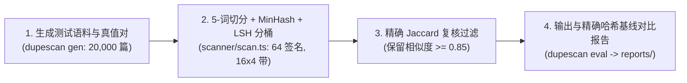

# dupescan

[English](README.md) | [简体中文](README.zh-CN.md)

**找出“换了件外套”的近重复文本。** `dupescan` 对文档做归一化与 5-gram 词片切分（shingling），计算 64 维 MinHash 签名并通过 16 个 LSH 分带筛选候选对，最后使用**精确 Jaccard 相似度**二次复核——既避免 $O(N^2)$ 全量比对，又保证输出相似度是实测值而非估算值。

```console
$ python scripts/demo.py
dupescan 0.1.0  20,000 documents  1,307 truth pairs
minhash  P 1.000  R 1.000  F1 1.000  (1,307 pairs, 6922 docs/s)
exact    P 1.000  R 0.601  F1 0.750  (785 pairs, 46736 docs/s)
```

## 操作工作流与流程图



## 算法流水线

| 阶段 | 实现 |
| --- | --- |
| 归一化 | 转小写，保留 `[a-z0-9']+` |
| 词片切分 | 5 词滑动窗口 + MurmurHash3 |
| 签名草图 | 模 $2^{31}-1$ 乘加置换生成 64 个 MinHash 值 |
| LSH 分带 | 16 个带 × 每带 4 行，任意一带撞桶即成为候选对 |
| 精确复核 | 在原始词片集合上计算精确 Jaccard，仅保留 `≥ 0.85` |

## 实测对比（20,000 篇文档，1,307 对真值重复）

| 方法 | Precision | Recall | F1 | 检出对数 | 吞吐量 |
| --- | --- | --- | --- | --- | --- |
| MinHash + LSH（精确复核） | 1.000 | 1.000 | 1.000 | 1,307 | 6,922 docs/s |
| 精确文本哈希 | 1.000 | 0.601 | 0.750 | 785 | 46,736 docs/s |

## 快速开始与分步工作流

```bash
python scripts/demo.py
```

分步执行（需要 Node 22.6+ 与 Python 3.11+，零 `node_modules`）：

```bash
PYTHONPATH=python/src python -m dupescan gen --count 20000 --docs data/docs.jsonl --truth data/truth.json
node --experimental-strip-types scanner/scan.ts --docs data/docs.jsonl --out data/pairs.json
node --experimental-strip-types scanner/scan.ts --docs data/docs.jsonl --out data/exact.json --exact
PYTHONPATH=python/src python -m dupescan eval \
  --truth data/truth.json --pairs data/pairs.json --baseline data/exact.json --out reports
```

## 边界与测试

- 基于词面重叠（lexical），不识别跨语种翻译或同义改写。
- 单机单进程内存执行（20,000 × 64 × 4B 约占 5 MB）。

```bash
PYTHONPATH=python/src python -m unittest discover -s python/tests -t python/tests -v
cd python && pip install -e ".[dev]" && ruff check . && mypy
```

MIT，详见 [LICENSE](LICENSE)。
